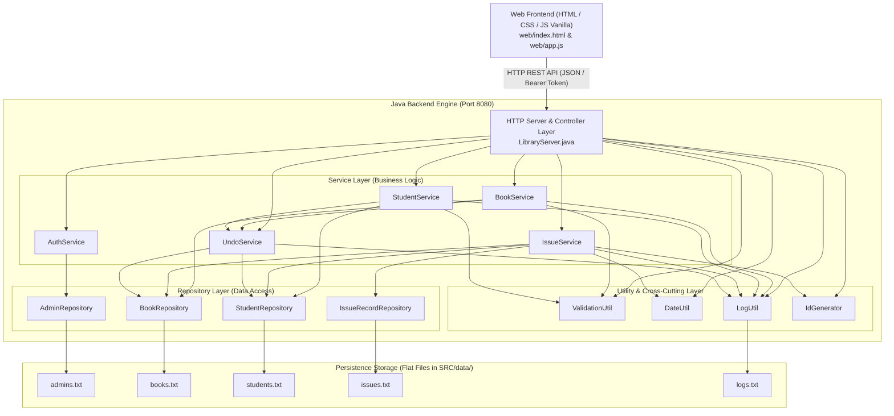
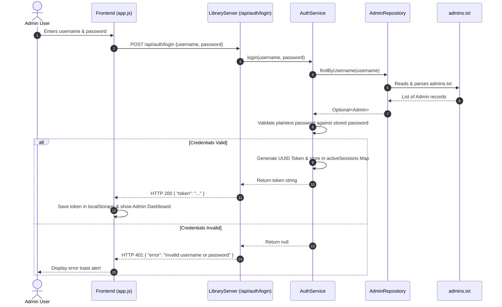
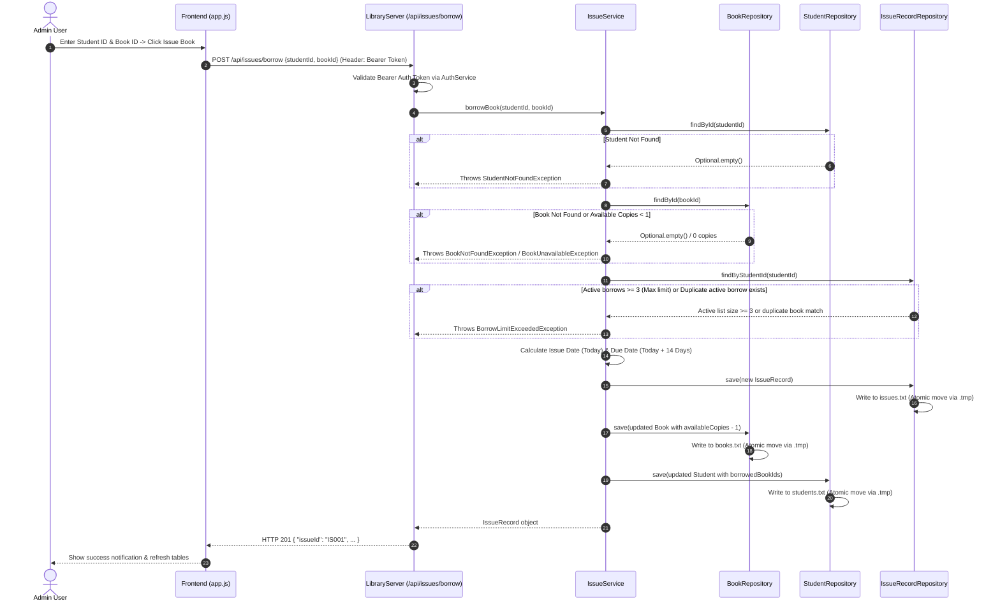
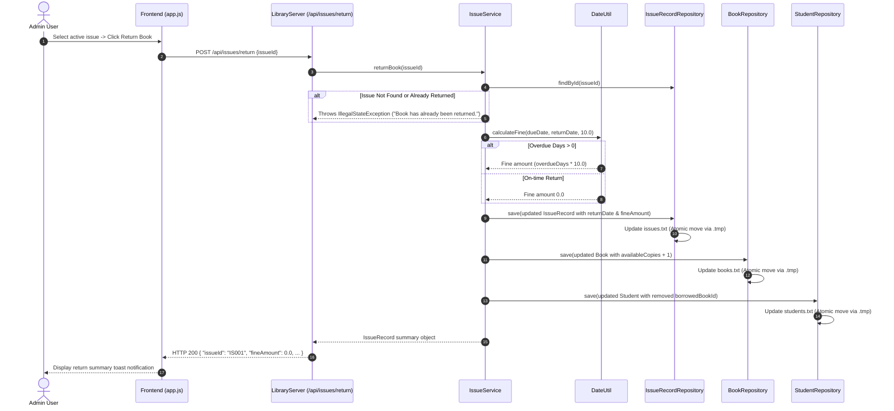
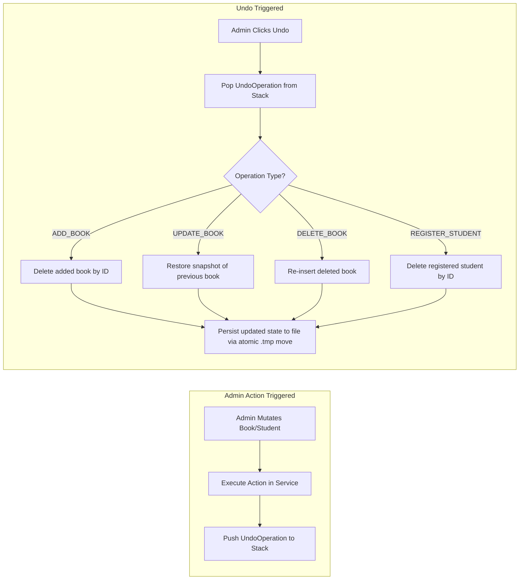
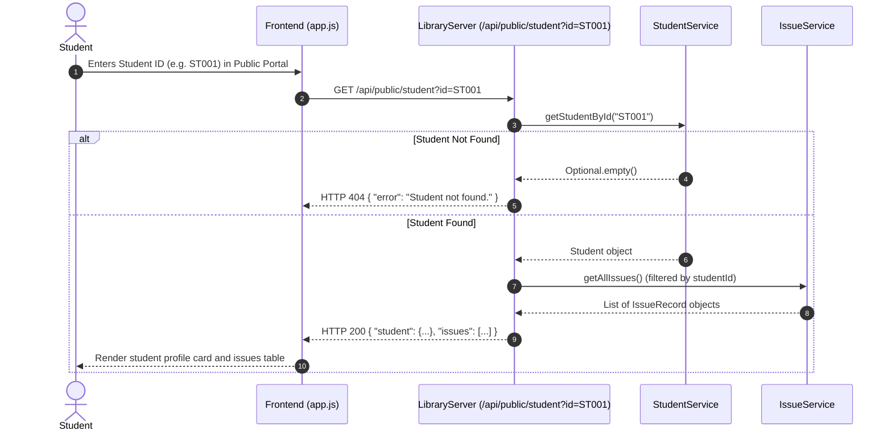

# Smart Library Management System — Viva & Architecture Guide (v1.4)

> [!NOTE]
> This guide provides a complete architectural breakdown, module-by-module execution flows, sequence diagrams, data persistence specs, and viva/interview preparation Q&As for the **Smart Library Management System**.

---

## 1. System Architecture Overview

The system follows a classic **4-Layer Architecture** decoupled into a lightweight HTML/JS frontend and a pure Java HTTP server backend.

---

## 2. Module-by-Module Flow Diagrams

### A. Authentication Module Flow

This module handles admin login and session token generation using memory-bound tokens stored in `ConcurrentHashMap<String, String>`.

---

### B. Book Issue Module Flow (Borrow Operation)

Handles student book borrowing, enforcing maximum borrow limit (3 books), duplicate borrow checks, and stock availability.

---

### C. Book Return & Fine Calculation Module Flow

Handles book return, checks overdue status, calculates fines dynamically (Rs. 10.00/day), and restores available copy counts.

---

### D. Undo Mechanism Module Flow (LIFO Stack Pattern)

Allows reversing administrative mutations (adding/updating/deleting books or registering students) using an in-memory stack.

---

### E. Public Student Portal Lookup Flow

Unauthenticated endpoint allowing students to view their profile and borrowing history by Student ID.

---

## 3. Data Persistence & File Schema Specifications

The application uses plain text `.txt` files with line-separated, pipe-delimited (`|`) values stored in `SRC/data/`.

| Entity File | File Path | Field Schema Format | Sample Real Data Row |
| :--- | :--- | :--- | :--- |
| **Books** | `SRC/data/books.txt` | `BookID\|ISBN\|Title\|Author\|Category\|Publisher\|Year\|TotalCopies\|AvailableCopies\|ShelfNumber` | `BK001\|978-0134685991\|Effective Java\|Joshua Bloch\|TECHNOLOGY\|Addison-Wesley\|2018\|5\|5\|A-12` |
| **Students** | `SRC/data/students.txt` | `StudentID\|Name\|Department\|PhoneNumber\|EmailAddress\|BorrowedBookIds` | `ST001\|Tejesh Reddy\|Computer Science\|9876543210\|tejesh.reddy@example.com\|BK001` |
| **Issues (Active)** | `SRC/data/issues.txt` | `IssueID\|StudentID\|BookID\|IssueDate\|DueDate\|ReturnDate\|FineAmount` | `IS001\|ST001\|BK001\|2026-09-01\|2026-09-15\|\|0.0` |
| **Issues (Returned)** | `SRC/data/issues.txt` | `IssueID\|StudentID\|BookID\|IssueDate\|DueDate\|ReturnDate\|FineAmount` | `IS001\|ST001\|BK001\|2026-09-01\|2026-09-15\|2026-09-14\|0.0` |
| **Admins** | `SRC/data/admins.txt` | `AdminID\|Username\|Password` | `AD001\|admin\|admin123` |
| **Logs** | `SRC/data/logs.txt` | `[Timestamp] [LOG_LEVEL] Log Message` | `[2026-10-03 20:40:12] [INFO] Server started on http://localhost:8080` |

---

## 4. Key Business Rules Reference

1. **Borrow Limit**: Maximum **3 active (unreturned) books** per student (`MAX_BORROW_LIMIT = 3`).
2. **Duplicate Borrow Guard**: A student cannot borrow a second copy of a book they already currently hold.
3. **Loan Duration**: Fixed **14 calendar days** from the issue date (`DEFAULT_BORROW_DURATION_DAYS = 14`).
4. **Overdue Fine**: **₹10.00 per day** past the due date (`FINE_PER_DAY = 10.0`).
5. **Book Deletion Rule**: A book cannot be deleted if any copies are currently borrowed (`availableCopies != totalCopies`).
6. **Session Management**: Session tokens are stored in a `ConcurrentHashMap<String, String>`. Tokens do not expire automatically and there is no `/api/auth/logout` HTTP endpoint. Server restarts reset active sessions.
7. **Input Validation Rules**:
   - Phone number: Exactly 10 digits (`^\d{10}$`).
   - Email: Standard email regex (`ValidationUtil.isValidEmail`).
   - Publication year: Between 1000 and current year.

---

## 5. Comprehensive Viva & Interview Q&A Guide

### Section A: Architecture & Core Design

#### Q1: What architectural pattern does this project follow?
> **Answer:** The project follows a **4-Layer Architecture**:
> 1. **Presentation Layer**: HTML5, CSS3, and JavaScript (Vanilla SPA style).
> 2. **Controller/HTTP Layer**: Java's built-in `com.sun.net.httpserver.HttpServer` listening on port 8080 (`StaticFileHandler` and `ApiHandler`).
> 3. **Service Layer**: Business logic enforcement (`BookService`, `StudentService`, `IssueService`, `AuthService`, `UndoService`).
> 4. **Repository Layer**: Data persistence (`BookRepository`, `StudentRepository`, `AdminRepository`, `IssueRecordRepository`).

#### Q2: How is data written safely to flat files to prevent file corruption during writes?
> **Answer:** Repositories use an **Atomic Single-File Swap** strategy: records are serialized into a temporary file (`.tmp.<timestamp>`), and once fully written, `Files.move(..., REPLACE_EXISTING, ATOMIC_MOVE)` atomically replaces the original target file. This prevents half-written or corrupted files if an error occurs mid-write.

#### Q3: How is REST authentication handled without external libraries like Spring Security?
> **Answer:** Admin login requests sent to `/api/auth/login` authenticate against `admins.txt`. Upon success, `AuthService` generates a UUID token and stores it in an in-memory `ConcurrentHashMap<String, String>` mapping token to username. Protected API endpoints verify the token via the `Authorization: Bearer <token>` request header.

---

### Section B: Data Structures & Algorithms

#### Q4: How is the Undo feature implemented?
> **Answer:** The Undo feature uses a **LIFO (Last-In, First-Out) Stack** (`java.util.Stack<UndoOperation>`). When an administrator adds, updates, or deletes a book or registers a student, an `UndoOperation` storing operation metadata and state snapshots is pushed onto the stack. Clicking "Undo" pops the top operation and restores previous state in memory and text files.

#### Q5: What is the ID format and generation mechanism for entities?
> **Answer:** `IdGenerator.generateId(existingIds, prefix)` parses numeric suffixes across existing entity IDs, identifies the maximum numeric value, increments it by 1, and formats it with a 3-digit zero-padded prefix (e.g. `BK001`, `ST001`, `IS001`, `AD001`).

---

### Section C: Concurrency & Error Handling

#### Q6: How does the backend map domain exceptions to HTTP responses?
> **Answer:** `LibraryServer.ApiHandler` catches domain exceptions (`StudentNotFoundException`, `BookNotFoundException`, `BookUnavailableException`, `BorrowLimitExceededException`, `IllegalStateException`) and converts them into standard HTTP status codes (HTTP 400 Bad Request or HTTP 404 Not Found) with a structured JSON error body: `{"error":"<message>"}`.

#### Q7: How is Path Traversal security handled?
> **Answer:** `StaticFileHandler` resolves incoming path strings against `webRoot.getCanonicalFile()` and verifies that `requestedFile.getPath().startsWith(webRootPath)`. Requests attempting relative directory traversal (such as `/../SRC/data/admins.txt`) or containing null bytes are rejected with **HTTP 403 Forbidden**.

---

## 6. Quick Reference Summary

| Metric / Parameter | Value / Detail |
| :--- | :--- |
| **Backend Port** | `http://localhost:8080` |
| **Default Admin Credentials** | Username: `admin` \| Password: `admin123` |
| **JDK Requirement** | Java 8 or higher (No third-party libraries needed) |
| **Data Directory** | `SRC/data/` |
| **Max Borrow Limit** | 3 books per student |
| **Loan Period** | 14 days |
| **Late Fine Rate** | ₹10.00 per day |
